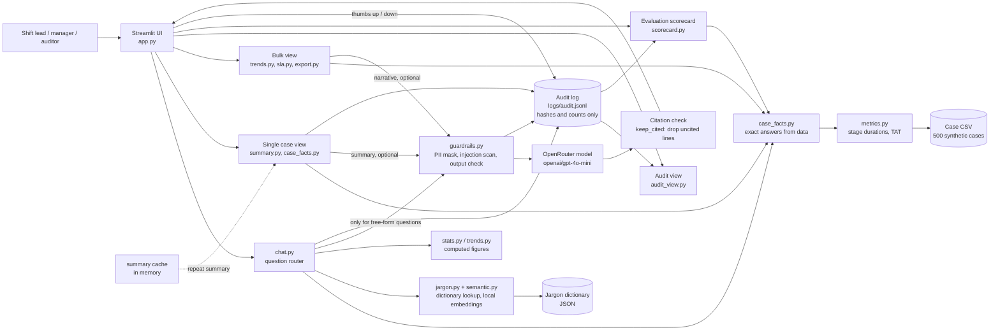

# CaseLens: Architecture

## Diagram

## Components

| Component | File | Role |
|---|---|---|
| UI | `app.py` | Pages, navigation, chat panel, exports |
| Question router | `chat.py` | Decides how to answer each question; refuses out-of-scope and PII requests |
| Case facts | `case_facts.py`, `summary.py` | Exact answers and case cards, computed from the CSV |
| Metrics | `metrics.py` | Stage durations and total turnaround from timestamps |
| Glossary | `jargon.py`, `semantic.py` | Dictionary matching; local embedding search, no data leaves the machine |
| Trends and SLA | `trends.py`, `stats.py`, `sla.py` | Bulk figures, SLA breaches, closed-date basis |
| Guardrails | `guardrails.py` | Masking check, injection scan, audit writer |
| Citation check | `summary.py` (`keep_cited`) | Drops any model line without a valid source |
| Scorecard | `scorecard.py` | Measures grounding, hallucination, PII leaks, latency |
| Audit | `audit_view.py` | Reads the audit log: latency, tokens, cost, feedback, prompt versions |
| Exports | `export.py`, `export_extra.py` | Excel bulk report, CSV tables, PDF case card |

## Data flow and controls

1. **Facts first.** Case figures are computed in code from the CSV. The model never calculates.
2. **Glossary only.** A dictionary term is explained only from its dictionary entry. Unknown terms return "not in the glossary".
3. **Model input is masked.** Client names, emails, phones, and account numbers are masked before any model call.
4. **Model output is checked.** Every model line must cite a valid source (`[M#]`, `[C#]`, or `[JD-###]`). Lines without one are dropped and counted.
5. **Repeat summaries are cached** in memory, keyed by a hash of the case prompt, system prompt, and model. A changed case or prompt gives a new key.
6. **Everything is logged.** Each model call, guardrail block, cache hit, and feedback vote is an audit event with hashes and counts. Raw questions and keys are never logged.
7. **Human decides.** Every card carries a decision-support label, and users can mark answers helpful or not.

## Deployment

- Runs locally: `py -m streamlit run app.py` from the `caselens` folder.
- Model key and price are read from `caselens/.env`.
- No database. The CSV, dictionary, and audit log are files.
